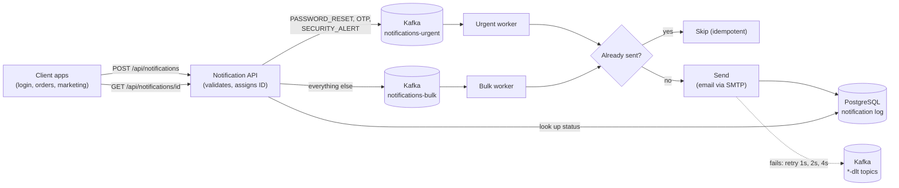

# Notification Service

An event-driven notification service built with **Spring Boot**, **Apache Kafka**, and **PostgreSQL**.

Other applications call one simple API to notify a user (email, SMS, or push). The service queues each request in Kafka, sends it asynchronously, and keeps a record of everything it sent. It is designed to stay responsive during traffic spikes, keep urgent messages fast, never send the same notification twice, and never lose a message when something fails.

---

## Architecture



**Request flow**

1. A client sends a notification request to the API.
2. The API validates the input, assigns a unique `notificationId`, publishes the event to Kafka, and responds immediately with **202 Accepted**.
3. The event goes to the **urgent** or **bulk** topic depending on its type.
4. A dedicated worker for each topic consumes the event, skips it if it was already sent, sends it, and records it in PostgreSQL as `SENT`.
5. If sending fails, the worker retries with exponential backoff. If it still fails, the event is moved to a dead-letter topic for review.
6. Clients can look up any notification's status by ID.

---

## Key design decisions

| Decision | Why |
|---|---|
| **Asynchronous API (202 Accepted)** | Callers never wait on email or SMS providers. The API only validates and queues. |
| **Kafka between the API and the senders** | Absorbs traffic spikes (for example, a marketing campaign) and keeps messages safe if a sender is down. |
| **Separate urgent and bulk topics, each with its own consumer** | A password reset never waits behind a million promotional emails. The urgent types are configurable in `application.yml`. |
| **The service decides priority, not the caller** | Callers cannot mark everything as urgent and clog the fast lane. The policy lives in one place. |
| **Message key = `userId`** | All notifications for one user land in the same partition, so they stay in order. |
| **Idempotent consumer** | Kafka delivers at least once, so duplicates can happen. Each worker checks the database by `notificationId` before sending, so a redelivered message is skipped. |
| **Retry with exponential backoff (1s, 2s, 4s)** | Short provider outages fix themselves without hammering a struggling provider. |
| **Dead-letter topics (`*-dlt`)** | Messages that still fail after retries are kept, with the original topic and error in their headers, so nothing is lost and support can investigate and replay them. |
| **`ErrorHandlingDeserializer`** | A malformed ("poison") message is moved to the dead-letter topic instead of blocking the partition. |
| **Notification log in PostgreSQL** | Gives an audit trail and powers the status lookup API. |

---

## Tech stack

- **Java 21**, **Spring Boot 3.5**
- **Spring Web** and **Bean Validation** for the REST API
- **Spring Kafka** with **Apache Kafka 3.9** (KRaft mode, no ZooKeeper)
- **Spring Data JPA** with **PostgreSQL 16**
- **Spring Mail** (SMTP), with **Mailpit** as a local test mail server
- **Docker Compose** for local infrastructure, **Kafka UI** for inspecting topics

---

## Running locally

**Prerequisites:** Docker Desktop and Java 21.

**1. Start the infrastructure**

```bash
docker compose up -d
```

| Service | URL / port |
|---|---|
| Kafka | `localhost:9092` |
| Kafka UI | http://localhost:8090 |
| PostgreSQL | `localhost:5432` (db `notifications`, user `notify`) |
| Mailpit SMTP | `localhost:1025` |
| Mailpit inbox | http://localhost:8025 |

**2. Run the application**

Run `NotificationServiceApplication` from your IDE, or:

```bash
./mvnw spring-boot:run
```

The API starts on http://localhost:8080. Kafka topics and the database table are created automatically on startup.

---

## API

### Send a notification

`POST /api/notifications`

```bash
curl -X POST http://localhost:8080/api/notifications \
  -H "Content-Type: application/json" \
  -d '{
        "userId": "user-42",
        "channel": "EMAIL",
        "type": "PASSWORD_RESET",
        "recipient": "user@example.com",
        "message": "Click here to reset your password."
      }'
```

**202 Accepted**

```json
{ "notificationId": "37fe2959-177a-471b-a798-910d7a8fee02", "status": "ACCEPTED" }
```

| Field | Rules |
|---|---|
| `userId` | required |
| `channel` | required: `EMAIL`, `SMS`, or `PUSH` |
| `type` | required, for example `PASSWORD_RESET`, `OTP`, `ORDER_CONFIRMED`, `PROMO` |
| `recipient` | required: email address, phone number, or device ID |
| `message` | required |

Invalid input returns **400 Bad Request**.

### Look up a notification

`GET /api/notifications/{id}`

```bash
curl http://localhost:8080/api/notifications/37fe2959-177a-471b-a798-910d7a8fee02
```

Returns **200 OK** with the stored notification (including its `status`), or **404 Not Found** if the ID does not exist.

---

## Configuration

Key settings in `src/main/resources/application.yml`:

```yaml
app:
  kafka:
    urgent-topic: notifications-urgent
    bulk-topic: notifications-bulk
    urgent-types: PASSWORD_RESET,OTP,SECURITY_ALERT
  mail:
    from: noreply@loki-notifications.com

spring:
  mail:
    host: localhost
    port: 1025
```

To send real email, point `spring.mail.*` at a provider such as Amazon SES or SendGrid. No code changes are needed.

---

## Try the resilience features

**Urgent vs. bulk lanes:** send one `PASSWORD_RESET` and one `PROMO`. The logs show them handled by different consumer threads (`[ntainer#0...]` and `[ntainer#1...]`).

**Duplicate protection:** publish an event whose `notificationId` already exists (for example, with `kafka-console-producer.sh` or Kafka UI's **Produce Message**). The worker logs `Skipping duplicate notification` and does not send it again.

**Retries and dead-letter topic:** stop the `mailpit` container and send an email notification. The worker retries after 1s, 2s, and 4s, then moves the event to `notifications-urgent-dlt` (or `notifications-bulk-dlt`). Start Mailpit again; new emails go through, and the failed one can be replayed by producing it back to its original topic.

---

## Project structure

```
src/main/java/com/loki/notification
├── api/          NotificationController       REST endpoints
├── config/       KafkaTopicConfig             creates topics and dead-letter topics
│                 KafkaErrorConfig             retries with backoff, then dead-letter
├── email/        EmailSender                  sends email over SMTP
├── kafka/        NotificationProducer         chooses the lane and publishes to Kafka
│                 NotificationWorker           consumes, deduplicates, sends, saves
├── model/        NotificationRequest          API input, with validation rules
│                 NotificationEvent            the Kafka message
│                 Notification                 JPA entity (notification log)
│                 Channel                      EMAIL, SMS, PUSH
└── repository/   NotificationRepository       Spring Data JPA repository
```

---

## Known limitations and next steps

These are deliberate simplifications for a local project, and how they would be addressed in production:

- **Idempotency edge cases.** The check-then-send approach handles redelivered messages, but a crash between sending and saving could still cause one duplicate. Production options include recording a `PENDING` status before sending, a unique constraint, or provider-side idempotency keys.
- **SMS and push are simulated** (logged only). Next step: integrate a provider such as Twilio or Firebase Cloud Messaging behind the same worker.
- **Schema management.** Tables are created by Hibernate `ddl-auto: update`. Production would use versioned migrations (Flyway or Liquibase).
- **Dead-letter replay is manual.** A small admin endpoint could move reviewed messages back to their original topic.
- **No authentication.** Next step: secure the API with Spring Security (OAuth2 / JWT) so only approved services can send notifications.
- **Testing.** Next step: unit tests and integration tests with Testcontainers for Kafka and PostgreSQL.
- **Dependencies** should be kept up to date to pick up security fixes.
- **Containerize the application** itself and add CI with GitHub Actions.
